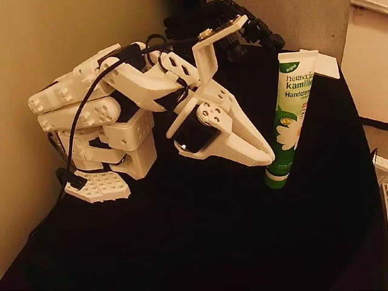
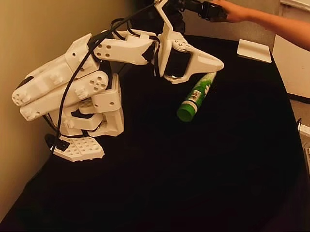
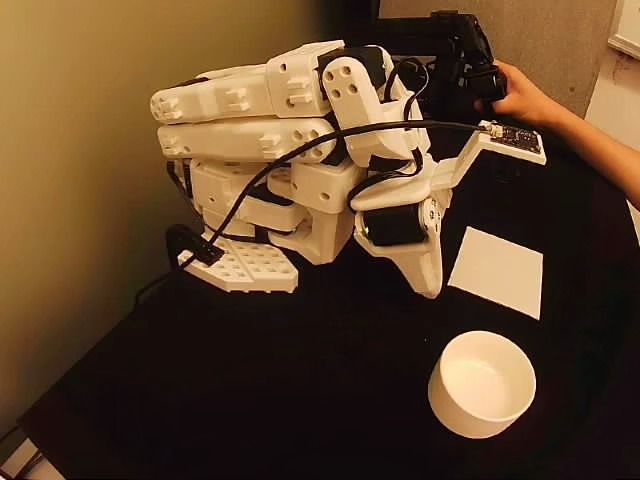
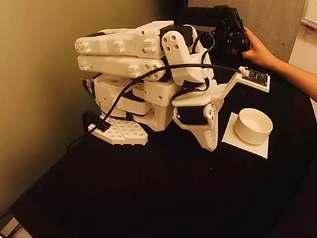

# SO101 cup and hand-cream joint SFT

Train the original H10 PI0.5 base on the two SO101 tasks below.
This recipe uses Carrot's existing trainer, FSDP and SO101 preprocessing. Its local
`dataset.py` is loaded through `dataset.factory`; no core training changes are required.

## Tasks and prompts

Each training sample uses its task's prompt below. The images show recorded
demonstrations from the top camera.

### Hand-cream knock-over

Push the upright green-and-white hand-cream tube over so it lies on the table.

```text
Knock over the upright green-and-white hand cream tube on the table.
```

| Start: upright tube | End: tube knocked over |
| --- | --- |
|  |  |

<!-- Source: knock-over-hand-cream-n99-v1, episode_index=0, frame_index=0 and 79. -->

### Cup pick-and-place

Grasp the cup, move it to the white square, set it down upright, and release it.

```text
Pick up the cup and place it upright within the white square on the table, then release it.
```

| Start: cup outside the target | End: cup placed and released |
| --- | --- |
|  |  |

<!-- Source: cup-to-white-square-multi-n60-v1, episode_index=0, frame_index=0 and 134. -->

## Fixed inputs and sampling

`inputs.json` pins each release's repository, commit and content hashes. Supply
existing local release directories under `--data-root`:

```text
<data-root>/
  knock-over-hand-cream-n99-v1/
  cup-to-white-square-multi-n60-v1/
```

| Task | Episodes | Frames | Approximate sampling share |
| --- | ---: | ---: | ---: |
| Hand cream | 99 | 3447 | 33.8638% |
| Cup | 60 | 6732 | 66.1362% |
| Total | 159 | 10179 | 100% |

The existing distributed sampler samples frame anchors from a `ConcatDataset`.
These shares follow frame counts, not episode counts or an exact per-batch quota.
Source episode boundaries, task prompts and H10 tail padding remain unchanged;
the videos are not merged or rewritten. Both cameras are 640x480 RGB at 15 FPS.
Actions are six absolute joint targets: five joint angles in degrees and gripper
opening in percent. Frame-index alignment is not a claim of hardware synchronization.

All episodes belong to the training set. This recipe does not create an independent
test set or establish physical task success from training loss.

The organization also hosts private copies:

- [Hand cream n99](https://huggingface.co/datasets/jason-so101/knock-over-hand-cream-n99-v1)
- [Cup multi-n60](https://huggingface.co/datasets/jason-so101/cup-to-white-square-multi-n60-v1)

Download both datasets to the local data directory before running this recipe.
Before training, dataset files are checked against the recorded checksums;
HF download cache and Git metadata are ignored.
The pinned release manifest supplies the checksums; `SHA256SUMS` is an optional
release sidecar unless the manifest explicitly lists it.

## Normalization and training protocol

Both tasks share `assets/pi05_norm_stats.json`. For inference, use the normalization
saved with the checkpoint.

Train from the H10 PI0.5 base for 45000 steps on eight GPUs with BF16 FSDP,
global batch 64 and learning rate 1e-6. Save checkpoints every 5000 steps.
See `train.template.yaml` for the full settings.
You can adjust training settings in the generated `train.yaml`; preflight checks
their validity and data/model compatibility without requiring the template's values.
Multi-GPU runs still require FSDP; Carrot does not fall back to DDP when it is disabled.

## Experiment results and RTC

The original joint experiment completed with 30k, 40k and 45k checkpoints retained.
Physical trials successfully demonstrated hand-cream knock-over and cup grasping.

Final checkpoint (45k), relative to `${MY_DFS}`:

```text
experiments/carrot/pi05_sft_so101_cup_n60_hand_n99_h10_45000/20261029T121200Z-attempt3/model/checkpoints/step-00045000
```

The 30k and 40k checkpoints are in the same parent directory as `step-00030000`
and `step-00040000`.

RTC (real-time chunking) overlaps action execution with the next prediction. In the
existing joint-30k deployment, each prediction contains 10 actions. After executing
`A1-A5`, the client requests `B1-B10`, using the remaining `A6-A10` as guidance while
those old actions continue executing. The response is buffered until handover;
`B1-B5` overlaps the committed actions and is skipped, then execution uses `B6-B10`:

```text
Executed: A1-A5 -> A6-A10 -> B6-B10 -> C6-C10 ...
```

At 5 Hz, the five committed actions allow one second for the next prediction.
The trials achieved timely chunk handovers, but physical motion still showed
visible stutter; the specific cause remains under investigation.

## Configure and validate

Use Python 3.12 with the repository's SFT dependencies. Run from an isolated source
checkout containing both `src/` and this recipe; an installed wheel alone does not
contain recipes. Freeze that checkout for the lifetime of a run. The launcher puts
the checkout and `src/` first on `PYTHONPATH`, which Carrot passes to Ray workers.

Paths are explicit deployment inputs. In the existing Gemini layout, model assets
are under `${MY_DFS}/models`, releases under `${MY_DFS}/datasets/hf_releases`, and
run outputs under `${MY_DFS}/experiments/carrot`. Confirm the target host's mounted
personal root and existing resources before use; do not relocate them for this recipe.

From the repository root, after activating the intended training environment:

```bash
RECIPE=recipes/pi05_sft_so101_cup_n60_hand_n99_h10_45000
RUN_DIR="$MY_DFS/experiments/carrot/joint-cup-hand-cream/UNIQUE_RUN_ID"
python "$RECIPE/configure.py" \
  --data-root "$MY_DFS/datasets/hf_releases" \
  --model-path "$MY_DFS/models/pi05_base_pytorch_h10" \
  --tokenizer-path "$MY_DFS/models/paligemma-3b-pt-224" \
  --run-dir "$RUN_DIR"
bash "$RECIPE/run.sh" --config "$RUN_DIR/train.yaml" --check-only
```

Replace `UNIQUE_RUN_ID` with a new run identifier. Configuration generation refuses
an existing run directory and cannot place outputs inside source/data/model paths.
It creates `train.yaml`, a read-only norm copy and `provenance.json`. Preflight
checks all release content hashes, shared normalization and model compatibility,
then decodes three sample windows per dataset (six total). It does not load model
weights or execute a GPU forward.
Output paths are checked again before launch, including resolved symlinks, so edits
to `train.yaml` cannot place checkpoints inside the source, datasets or model directories.

For a full acceptance check, also inspect each episode's beginning, middle and end
and recompute joint statistics for comparison (without changing the saved norm):

```bash
bash "$RECIPE/run.sh" --config "$RUN_DIR/train.yaml" --check-only --full
```

For a local data-only check when the model assets exist only on the training host:

```bash
PYTHONPATH="$PWD/src:$PWD${PYTHONPATH:+:$PYTHONPATH}" \
HF_HUB_OFFLINE=1 HF_DATASETS_OFFLINE=1 \
python -m recipes.pi05_sft_so101_cup_n60_hand_n99_h10_45000.preflight \
  --config /absolute/path/to/new-run/train.yaml --data-only
```

Add `--full` to the data-only command for the same complete dataset check.

## Train

Start Ray and set `RAY_ADDRESS`, then run the command below to validate the inputs
and start training:

```bash
bash "$RECIPE/run.sh" --config "$RUN_DIR/train.yaml"
```

After validation, the launcher atomically creates the output directory before
starting training. A duplicate launch using that output is rejected. Check-only
runs do not reserve it. If startup fails, the directory is kept; use a new run
directory or inspect the failed run before manually cleaning it up.

Use the site's tmux or background job mechanism if the run must outlive a terminal.
For example, after preparing the environment and exporting `RAY_ADDRESS`:

```bash
nohup bash "$RECIPE/run.sh" --config "$RUN_DIR/train.yaml" \
  >> "$RUN_DIR/train.log" 2>&1 < /dev/null &
tail -f "$RUN_DIR/train.log"
```

Training outputs are under `$RUN_DIR/model`. Record the actual source commit and
uncommitted changes or snapshot hashes, image/dependency versions, cluster address,
command, start/end time and exit status alongside each run. This entry is fresh-start
only; it does not resume an existing output directory. Verify final step and expected
checkpoint files separately from model loading and physical evaluation.

## Inference

Use Carrot's existing policy server with the checkpoint's tokenizer and joint
`norm_stats.json`. From the GPU checkout, in the serving environment:

```bash
export PYTHONPATH="$PWD/src:$PWD${PYTHONPATH:+:$PYTHONPATH}"
python -m carrot.cli.serve_pi05_policy \
  --embodiment so101 --checkpoint /absolute/path/to/step-00045000 \
  --device cuda:0 --host 0.0.0.0 --port 8000 --num-steps 10
```

The model returns `(10, 6)` absolute joint targets. `--num-steps` controls denoising
iterations, independently of the 10-action horizon. Training datasets are not
needed for live inference.

On the control computer, use the [SO101 client environment](../../examples/so101_real/README.md#环境与策略服务)
and run from the repository root with the same `PYTHONPATH` setting. Copy
[deployment.example.yaml](deployment.example.yaml) to your own `deployment.yaml`.
Set `server_uri` and an absolute `dataset_root` for the local cup release. The
default mode checks recorded observations and logs predictions without opening hardware:

```bash
python -m examples.so101_real.main \
  --config /absolute/path/to/deployment.yaml --output-dir outputs/joint-check-001
```

To check hand cream instead, set its local root and
`dataset_repo: jason-so101/knock-over-hand-cream-n99-v1`; `prompt: null` uses the
recorded task. Each run needs a new output directory.

For live execution, fill `robot_port`, `robot_id`, the absolute `calibration_dir`,
and camera indices/orientations in your copy. Both RGB views are 640x480 at 15 Hz,
matching the control rate. Keep the recorded view arrangement and exposure.
The example retains the stock client's motion limits and motor settings.
This command moves the robot for 10 chunks of 10 actions:

```bash
TASK_PROMPT='Pick up the cup and place it upright within the white square on the table, then release it.'
python -m examples.so101_real.main \
  --config /absolute/path/to/deployment.yaml \
  --observation-source robot --action-sink robot \
  --prompt "$TASK_PROMPT" --output-dir outputs/joint-live-001
```

Use the hand-cream prompt above to switch tasks with the same model. Stock
execution is synchronous and does not reset the robot to the leader afterward.

### Optional RTC and reset extensions

RTC requires both server-side action-prefix guidance and a client that requests
predictions in the background, skips the overlapping prefix at handover and stops
on a missed deadline. These extensions are separate from this recipe. For example,
the separate RTC-enabled live deployment uses the following H10 settings; these
extra keys are **not supported by the stock client**:

```yaml
fps: 5
rtc_enabled: true
rtc_inference_delay: 5
rtc_prefetch_steps: 5
```

This allows one second for each handover, as described in the RTC trial above.
The extended client must support camera capture rates above the control rate.

For reset, provide a separate script for your robot, leader and calibration, then
chain it after a successful live run. The reset script is not included here;
`&&` skips it if inference errors or is interrupted:

```bash
python -m examples.so101_real.main \
  --config /absolute/path/to/deployment.yaml \
  --observation-source robot --action-sink robot \
  --prompt "${TASK_PROMPT:?Set one of the task prompts above}" \
  --output-dir outputs/joint-reset-001 &&
bash /absolute/path/to/reset_to_leader.sh
```

## Tests and validation status

Run these checks from the repository root:

```bash
PYTHONPATH="$PWD/src:$PWD${PYTHONPATH:+:$PYTHONPATH}" \
HF_HUB_OFFLINE=1 HF_DATASETS_OFFLINE=1 \
python -m pytest -q "$RECIPE/tests"
python -m ruff check "$RECIPE"
python -m ruff format --check "$RECIPE"
bash -n "$RECIPE/run.sh"
```

| Check | Result |
| --- | --- |
| Unit tests | PASS: 139 tests |
| Dataset preflight | PASS: 159 episodes, 10179 frames |
| Code and shell checks | PASS |
